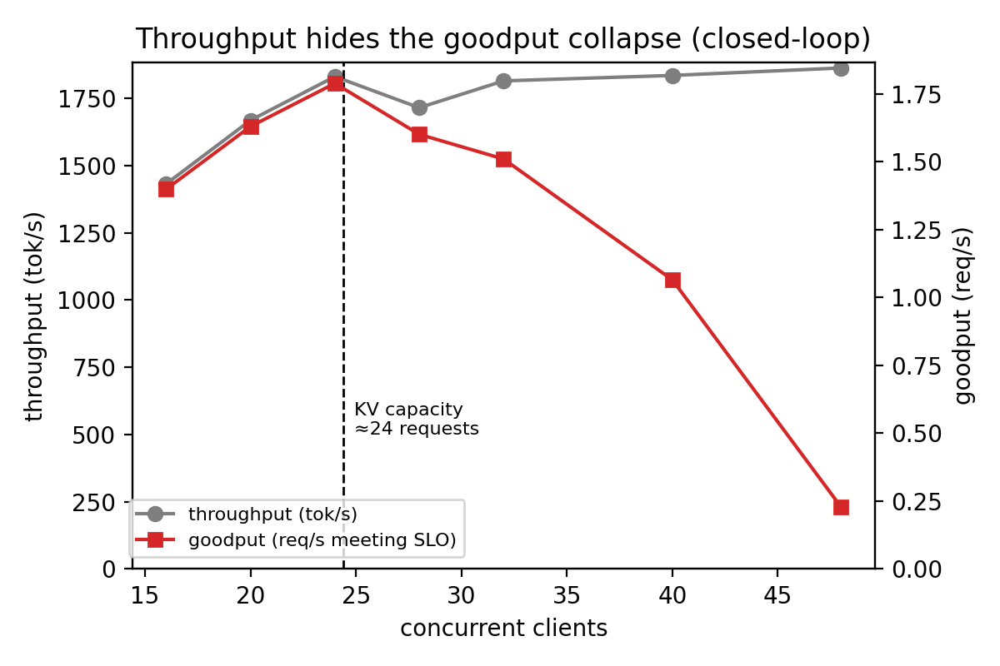
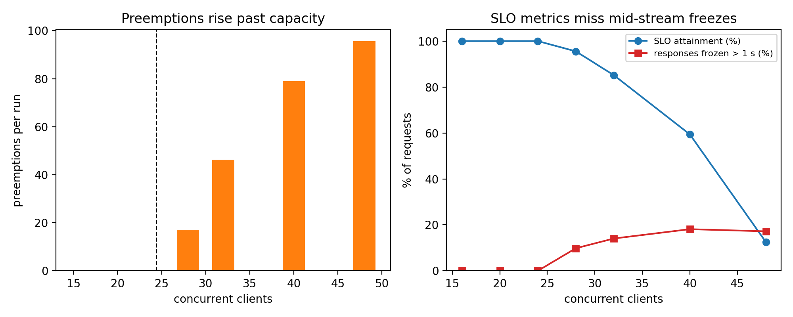
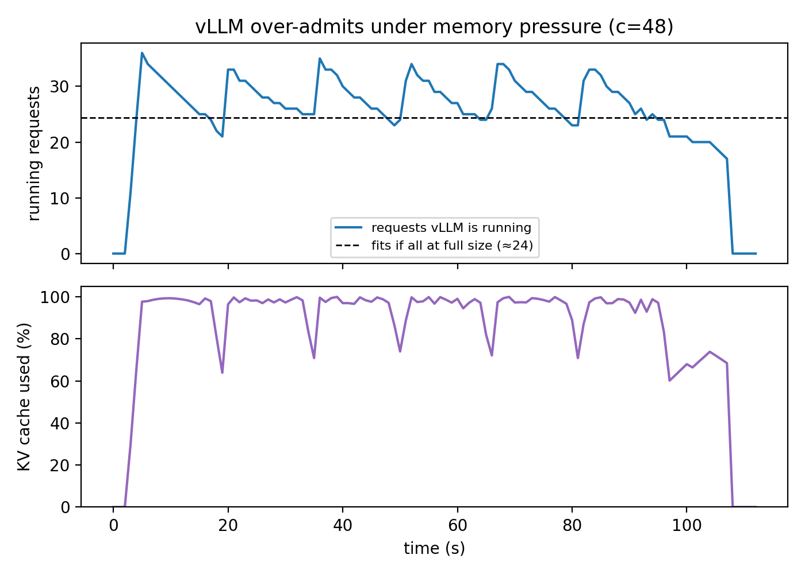
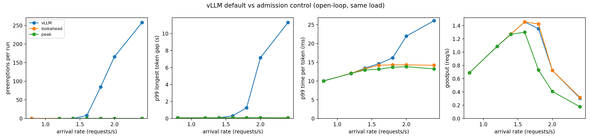
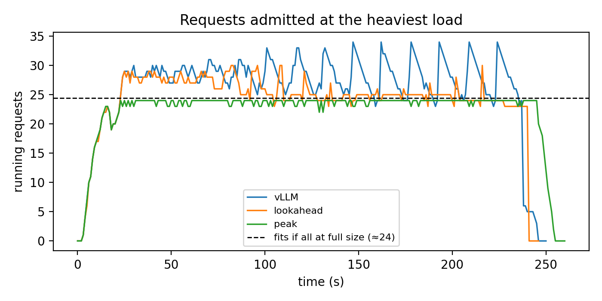
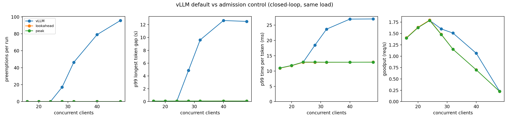
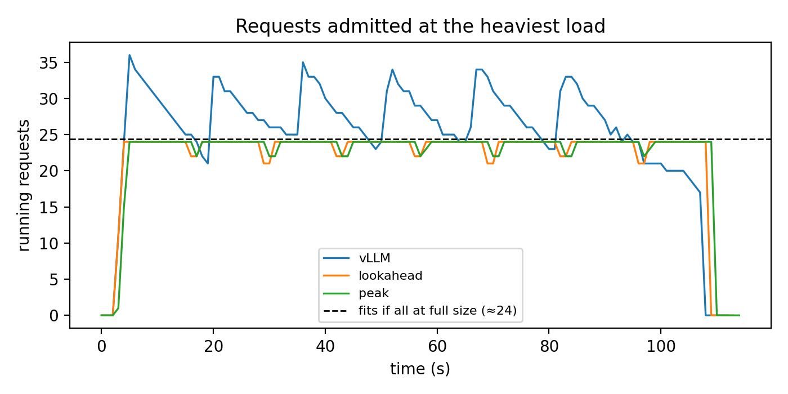

# KV-Cache-Aware Admission Control for vLLM

This project is a measurement harness and an admission controller for LLM serving. It shows that **vLLM over-admits requests under KV-cache memory pressure**, which leads to preemptions and multi-second mid-answer freezes that standard serving metrics don't catch. It then fixes this with a **lookahead admission controller** which is a small proxy in front of vLLM that admits a request only when it can prove no preemption will occur.

**Headline results** (same traffic, same GPU, same KV budget):

| | vLLM default | Static peak reservation | **With lookahead** |
|---|---|---|---|
| Preemptions (open-loop sweep) | 517 | 0 | **0** |
| Requests frozen > 1 s mid-answer | 78 | 0 | **0** |
| Worst token gap, p99 | 11.3 s | 0.10 s | **0.09 s** |
| Max concurrent requests | 34 (over capacity) | 24 | **30** |
| Goodput at 1.8 req/s | 1.35 req/s | 0.73 req/s | **1.43 req/s** |
| Proxy overhead | — | — | **+6 ms TTFT, 0 per token** |

---

## 1. The problem

During decoding, each request's KV cache grows by one token per step. vLLM admits a waiting request if there is memory for its **current** need (the prompt), not its **peak** need (prompt + output). Under load, it admits more requests than memory can hold. As they grow, memory runs out, and vLLM **preempts** running requests: it frees their KV blocks and later recomputes them.

To the user, a preempted request **freezes mid-answer** for seconds, then resumes. Standard metrics hide this:
- **TTFT** only measures the first token, which arrived before the freeze.
- **TPOT** is averaged over ~1,000 tokens, so one long freeze gets diluted.

## 2. Setup

| | |
|---|---|
| Cluster | HPC Cluster (Slurm) |
| GPU | NVIDIA A100 MIG slice (3g.20gb). A full A100 80GB was used as a cross-check |
| Serving | vLLM 0.8.5 (V1 engine, CUDA graphs on) in an Apptainer container |
| Model | Qwen2.5-1.5B-Instruct, bf16 |
| KV budget | pinned with `--num-gpu-blocks-override 4735` (block size 16, 75,760 tokens), so the memory wall is identical on any GPU |
| Workload `heavy` | ~2,077-token prompts with a unique UUID prefix (defeats prefix caching), exactly 1,024 output tokens (`ignore_eos`), temperature 0 |
| SLO | TTFT < 2 s **and** TPOT < 50 ms. *Goodput* = requests/s meeting the SLO |
| Load | **Closed-loop:** N concurrent clients (N = 16–48). **Open-loop:** Poisson arrivals at 0.8–2.4 req/s for 180 s, fixed seed so every system sees identical arrival times |

**Capacity from first principles:** a heavy request peaks at ⌈3,101 / 16⌉ = 194 blocks, so 4,735 / 194 = **24.4 requests** fit at full size. This was predicted before any measurement.

## 3. Phase 2: characterizing vLLM

### Closed-loop (MIG slice, CUDA graphs, 3 repeats per point)

| Clients | Goodput (req/s) | SLO | Throughput (tok/s) | Preemptions/run | Frozen > 1 s | Max running |
|---|---|---|---|---|---|---|
| 24 | **1.79** | 100% | 1,831 | 0 | 0 | 24 |
| 28 | 1.60 | 96% | 1,715 | 17 | 11 of 112 | 28 |
| 32 | 1.51 | 85% | 1,815 | 46 | 18 | 32 |
| 40 | 1.06 | 59% | 1,835 | 79 | 29 | 36 |
| 48 | **0.23** | 12% | 1,863 | 96 | 33 | 36 |

Findings:
1. **The knee is exactly at the predicted capacity (24).** Zero preemptions at 24, preemptions from 28 on.
2. **vLLM over-admits by ~50%**, running up to 36 requests when 24 fit.
3. **Throughput hides the collapse.** From 24 to 48 clients, throughput rises 2% while goodput falls **87%**.
4. **Standard SLOs miss the freezes.** At 28 clients the SLO reports 96% attainment, yet ~10% of responses froze mid-generation (p99 freeze 4.9 s). The `max_gap` metric (longest pause between two streamed tokens) was added to catch this.
5. **The limit is memory, not compute.** The same knee and over-admission appear on a full A100 80GB with the same 4,735-block budget.





The timeline shows the mechanism: vLLM spikes to ~35 running, memory hits 100%, it evicts requests one by one back down to ~24, a group finishes, and it over-admits again.

### Open-loop (Poisson arrivals, seed 0)

| Rate (req/s) | Goodput | SLO | Preemptions | Frozen > 1 s | Max running |
|---|---|---|---|---|---|
| 1.4 | 1.28 | 100% | 0 | 0 | **27** |
| 1.6 | 1.46 | 99% | 8 | 1 | 29 |
| 1.8 | 1.35 | 82% | 85 | 6 | 30 |
| 2.0 | 0.73 | 42% | 166 | 21 | 33 |
| 2.4 | 0.31 | 17% | 258 | 50 | 34 |

Note the 1.4 row: with staggered arrivals, **27 requests ran safely**, more than the 24 that fit when all are at full size, because requests at different stages hold different amounts of memory. The lookahead controller is designed to exploit exactly this.

## 4. Phase 3: the admission controller

`sentinel/proxy.py` is an asyncio (aiohttp) proxy between clients and vLLM. vLLM itself is unmodified.

```
client ──► Sentinel proxy (:8002) ──► vLLM (:8000)
           decides when each request is admitted
```

For each request it tracks:
- **P**: prompt tokens, counted exactly via vLLM's `/tokenize`
- **M**: `max_tokens`, an upper bound on output length
- **g**: tokens generated so far, counted live from the response stream

### Policies

| Policy | Admission rule |
|---|---|
| `none` | admit everything (used to measure proxy overhead) |
| `peak` | Σ ⌈(P + M) / 16⌉ over all requests ≤ budget. Static worst-case reservation |
| `lookahead` | admit only if projected KV usage never exceeds the budget at any future step |

### The lookahead rule

With continuous batching, every running request decodes exactly one token per step. So at *s* steps in the future, a request occupies ⌈(P + g + s) / 16⌉ blocks if it is still running (s ≤ M − g), and **zero** once it finishes. Total memory only drops when a request finishes, so the peaks are just before each finish. The controller therefore only checks s = M − g for each request:

```python
for s in {r.max_tokens - r.generated for r in reqs}:
    total = sum(blocks(r.prompt + r.generated + s)
                for r in reqs if r.max_tokens - r.generated >= s)
    if total > budget:
        return False
return True
```

Requests that don't fit wait in a FIFO queue at the proxy; **no request is ever rejected**. A 32-block safety margin absorbs prefill delays. Every other endpoint (`/metrics`, `/version`, …) is passed through unchanged.

## 5. Results

### Open-loop (realistic traffic, identical arrivals)

| Rate | Goodput: vLLM / peak / **lookahead** | SLO: vLLM / peak / **lookahead** | Preemptions: vLLM / peak / **lookahead** | Frozen > 1 s: vLLM / **lookahead** |
|---|---|---|---|---|
| 1.6 | 1.46 / 1.30 / **1.46** | 99% / 90% / **99%** | 8 / 0 / **0** | 1 / **0** |
| 1.8 | 1.35 / 0.73 / **1.43** | 82% / 46% / **86%** | 85 / 0 / **0** | 6 / **0** |
| 2.0 | 0.73 / 0.41 / **0.73** | 42% / 25% / **41%** | 166 / 0 / **0** | 21 / **0** |
| 2.4 | 0.31 / 0.18 / **0.32** | 17% / 10% / **18%** | 258 / 0 / **0** | 50 / **0** |

| | vLLM | peak | **lookahead** |
|---|---|---|---|
| Max running | 34 | 24 | **30** |
| Peak KV usage | 100% (overflowing) | ~87% | **99%** |
| TPOT p99 at 2.4 req/s | 26.1 ms | 13.2 ms | **14.2 ms** |
| Throughput at 2.0 req/s | 1,759 tok/s | 1,654 tok/s | **1,810 tok/s** |




**Lookahead vs vLLM:** all 517 preemptions and all 78 freezes eliminated (p99 token gap 11.3 s → 0.09 s), with steady per-token latency and equal or slightly higher throughput and goodput.

**Lookahead vs static peak reservation:** the same safety, but 25% more concurrent requests, 99% vs ~87% memory use, and up to **1.96× the goodput** (1.43 vs 0.73 req/s at 1.8 req/s).

### Closed-loop (lockstep traffic)

| Clients | Goodput: vLLM / **lookahead** | SLO: vLLM / **lookahead** | Preemptions: vLLM / **lookahead** | p99 token gap: vLLM / **lookahead** |
|---|---|---|---|---|
| 24 | 1.79 / **1.80** | 100% / **100%** | 0 / **0** | 0.09 / **0.09 s** |
| 28 | 1.60 / **1.48** | 96% / **86%** | 17 / **0** | 4.86 / **0.09 s** |
| 32 | 1.51 / **1.15** | 85% / **69%** | 46 / **0** | 9.62 / **0.09 s** |
| 48 | 0.23 / **0.22** | 12% / **12%** | 96 / **0** | 12.50 / **0.09 s** |




In closed-loop all clients start together, so admitted requests are always at the same stage and lookahead correctly falls back to peak's 24. Past capacity, the controller **moves waiting from mid-answer (a freeze) to before the first token**. The standard SLO penalizes the second (TTFT > 2 s) but not the first (a freeze averaged into TPOT), so vLLM scores higher at 28–40 clients. That gap comes from the metric's blind spot found in Phase 2, not from vLLM serving users better.

### Proxy overhead (1 client, nothing queued)

| | Direct | Through proxy |
|---|---|---|
| TTFT p50 | 89.8 ms | 96.2 ms (**+6 ms**, mostly the `/tokenize` call) |
| TPOT p50 | 7.12 ms | 7.05 ms (**no difference**) |

## 6. Limitations

- **Output length is planned with `max_tokens`.** In these experiments output length was fixed, so the bound was exact. In real traffic answers often stop early. The controller stays preemption-free (a request can never exceed its cap), but it reserves memory that is never used. If `max_tokens` = 1,024 but answers average 100 tokens, it would admit ~24 requests where ~34 fit, and vLLM's optimistic admission would do better.
- **Prefix sharing is ignored.** With shared prefixes the reservation is conservative.
- **One model, one request size, one GPU type.** Single seed per controller point; baseline repeats were near-identical.
- **Overload is not removed, only relocated.** Above ~1.8 req/s more work arrives than this GPU can finish, and requests wait regardless of the scheduler.

## 7. Future work

**A key observation from the data:** a preemption freeze lasted up to **12.6 s**, while recomputing a full request's KV takes about **0.1 s** (a ~2,077-token prefill measured at ~90 ms). So **over 98% of a freeze is waiting for memory to free up, not recomputation.** That shapes which fixes are worth building:

1. **Predictive admission.** Plan with a predicted output length (e.g., a running percentile of recent lengths, or a per-request-type predictor) instead of `max_tokens`. Correct the projection live as tokens stream, and keep vLLM's preemption as a rare fallback. This targets the main limitation above.
2. **Swap instead of recompute.** Offload an evicted request's KV to CPU memory and copy it back instead of recomputing (vLLM's V0 engine has a swap preemption mode; newer versions add KV-offloading connectors such as LMCache). Per the observation above, this saves the ~0.1 s of recompute but not the seconds of waiting, so for a small model it should barely shorten freezes. It matters for large models and long contexts, where recompute is expensive. Planned as a measurement: recompute vs swap cost across model sizes (1.5B vs 7B) and context lengths.
3. **KV-aware routing across GPUs.** Extend the proxy to several vLLM instances and send each request to the instance whose projected memory can hold it. This prevents preemption by placing work where memory is free, using the same lookahead math per instance.
4. **Live KV migration across GPUs.** When an instance is about to preempt, move a running request's KV cache to another GPU with free memory and continue decoding there, instead of evicting it (the approach of systems such as Llumnix). Unlike swapping, this removes the wait itself, since the request continues on another GPU immediately. This is the largest step and needs engine-level KV transfer.

## 8. Repository layout

```
benchmark/
  loadgen.py          closed-loop and open-loop (Poisson) load generator; TTFT, TPOT, max token gap, SLO, goodput
  run_experiment.py   runs one experiment and snapshots server config and metrics
  vllm_metrics.py     polls vLLM /metrics during a run (running, waiting, KV usage)
sentinel/
  proxy.py            the admission controller (policies: none, peak, lookahead)
analysis/
  summary.py          per-sweep results table
  plots.py            Phase 2 figures (closed- and open-loop)
  compare.py          vLLM vs peak vs lookahead comparison figures
results/              raw run folders (per-request CSVs, metric snapshots, run config)
figures/              all figures above
```

## 9. Reproducing

```bash
# 1. Start vLLM 0.8.5 (inside the container), with the KV budget pinned
vllm serve Qwen/Qwen2.5-1.5B-Instruct --port 8000 \
  --gpu-memory-utilization 0.3 --num-gpu-blocks-override 4735 --enable-prefix-caching

# 2. Start the controller
python3 sentinel/proxy.py --policy lookahead --port 8002     # or: peak, none

# 3. Closed-loop sweep (drop --url to hit vLLM directly)
for c in 16 20 24 28 32 40 48; do
  python3 benchmark/run_experiment.py --workload heavy --concurrency $c \
    --requests-per-worker 4 --min-requests 0 --url http://localhost:8002 \
    --results-dir results/knee_heavy_lookahead
done

# 4. Open-loop sweep
for r in 0.8 1.2 1.4 1.6 1.8 2.0 2.4; do
  python3 benchmark/run_experiment.py --workload heavy --arrival-rate $r --duration 180 \
    --seed 0 --url http://localhost:8002 --results-dir results/open_heavy_lookahead
done

# 5. Tables and figures
python3 analysis/summary.py results/open_heavy_lookahead/
python3 analysis/compare.py figures/compare_open vLLM=results/open_heavy_gpu20_test \
  lookahead=results/open_heavy_lookahead peak=results/open_heavy_peak
```
